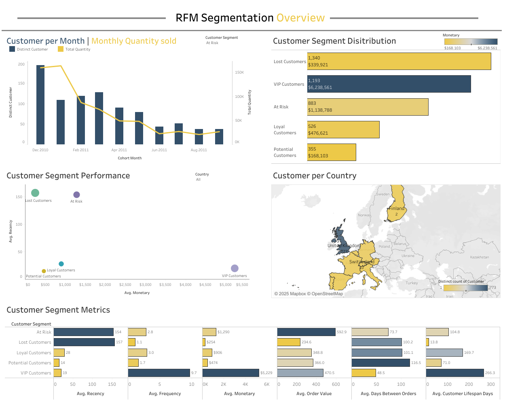

# Customer Retention & Lifecycle Value Analytics | Cohort & RFM Segmentation

**Project type:** Independent data analytics portfolio

**Reporting scope:** E-commerce transaction history (December 2010 – November 2011; 3,886 unique customers)

**Business context:** Diagnosing early post-acquisition churn, cohort decay, and revenue concentration across customer lifecycle segments

**Primary tools:** Microsoft SQL Server (T-SQL), Tableau Public, Microsoft Excel

[View the interactive Tableau Cohort | RFM Dashboard](https://public.tableau.com/views/Cohort-RFMcombineddashboard/cohort-RFM?:language=en-US&:sid=&:redirect=auth&:display_count=n&:origin=viz_share_link) | [Cohort Retention SQL Script](SQL_queries/cohort_retention.sql) | [RFM Segmentation SQL Script](SQL_queries/Customer_Segmentation.sql)

## Table of Contents

* [1. Project Overview](#1-project-overview)
* [2. Business Problem & Stakeholders](#2-business-problem--stakeholders)
* [3. Dataset Overview & Tools](#3-dataset-overview--tools)
* [4. Executive Summary](#4-executive-summary)
* [5. Exploratory Analysis: Iterative Hypothesis Loops](#5-exploratory-analysis-iterative-hypothesis-loops)
  * [5.1 Cohort Retention Trajectory (When Are Customers Leaving?)](#51-cohort-retention-trajectory-when-are-customers-leaving)
  * [5.2 RFM Value Segmentation (Who Sustains Revenue?)](#52-rfm-value-segmentation-who-sustains-revenue)
  * [5.3 Combined Cohort-RFM Diagnosis (The Month-1 Natural Filter)](#53-combined-cohort-rfm-diagnosis-the-month-1-natural-filter)
  * [5.4 Acquisition Quality by Cohort Month (Volume vs. Customer Quality)](#54-acquisition-quality-by-cohort-month-volume-vs-customer-quality)
* [6. Recommendations & Business Implications](#6-recommendations--business-implications)
* [7. Limitations & Further Investigation](#7-limitations--further-investigation)
* [8. Project Files & Deliverables](#8-project-files--deliverables)

---

## 1. Project Overview

Acquiring new e-commerce customers is expensive, yet top-line acquisition numbers often mask severe post-purchase drop-off. This project investigates **when customers churn, which customer segments actually generate sustainable revenue, and how acquisition quality shifted across monthly cohorts** between December 2010 and November 2011.

By pairing **time-based Cohort Retention modeling** with **behavioral RFM (Recency, Frequency, Monetary) quintile segmentation** in T-SQL and visualizing the combined lifecycle in Tableau, the analysis separates one-time seasonal buyers from high-tenure repeat buyers.

**Scope:** 12 monthly acquisition cohorts (`Dec 2010` through `Nov 2011`), excluding partial December 2011 records to prevent incomplete-month distortion.

[Back to Table of Contents](#table-of-contents)

## 2. Business Problem & Stakeholders

Leadership observed declining repeat purchase rates across 2011 customer cohorts compared to the December 2010 baseline. Relying solely on aggregate monthly revenue obscured whether the business was suffering from **broad product-market fit failure**, **seasonal acquisition dilution**, or **early onboarding friction**.

The **Head of Retention & CRM** commissioned an exploratory lifecycle investigation around four core questions:

| Analytical Dimension | Key Headline Metric | Diagnostic Objective |
| :--- | :--- | :--- |
| Cohort Retention Decay | **~75% drop after Month 1** | Pinpoint the exact lifecycle index where customer churn accelerates |
| Cohort Baseline Comparison | **50% Month-12 retention (Dec 2010)** vs. **<30% (2011 cohorts)** | Determine whether newer 2011 cohorts retain worse than initial baselines |
| Revenue Concentration | **\$6.24M from VIPs** vs. **\$340K from Lost Customers** | Quantify how much revenue depends on repeat power users vs. one-time buyers |
| Customer Lifespan Spread | **266.3 days (VIP)** vs. **13.8 days (Lost)** | Validate whether RFM segments accurately separate durable buyers from immediate churners |

Different internal teams proposed competing hypotheses to test rather than assume:

| Stakeholder Lens | Initial Hypothesis to Test |
| :--- | :--- |
| Acquisition Marketing | High-volume holiday cohorts (such as December 2010) produce the highest proportion of loyal customers |
| Retention / CRM | The sharp Month-1 retention drop represents uniform churn across all customer tiers |
| Merchandising / Ops | Revenue stability depends on broad repeat buying across the entire 3,886-customer base |

[Back to Table of Contents](#table-of-contents)

## 3. Dataset Overview & Tools

The pipeline transforms raw transactional invoice records (`Online_Retail`) into two structured analytical outputs in SQL Server before loading into Tableau:

| Source / Output Table | Role in the Analysis | Grain & Data Hygiene Rules |
| :--- | :--- | :--- |
| `Online_Retail_Main` | Cleaned transaction ledger with calculated line-item `Revenue = Quantity * UnitPrice` | **Invoice line-item grain**; excludes `NULL` `CustomerID`s, returns/cancellations (`Quantity <= 0`), zero/negative prices, and exact duplicate line items (`ROW_NUMBER() = 1`) |
| `Cohort_Retention` | Assigns each customer's `CohortDate` (first purchase month) and calculates `Cohort_Index` (months since first order, `1` to `12`) | **Customer × Transaction × Cohort Index**; excludes December 2011 (`NOT (Year = 2011 AND Month = 12)`) so incomplete month data does not artificially depress final-index retention |
| `RFM_Segments_Final` | Computes customer-level `Recency`, `Frequency`, `Monetary`, quintile scores (`NTILE(5)`), `CustomerLifespanDays`, and strategic segment labels | **One row per unique `CustomerID` (3,886 customers)**; dynamic `@analysis_date` anchored to latest valid invoice date |

**Tooling actually used:** Microsoft SQL Server (T-SQL window functions, `NTILE(5)` quintile scoring, `PIVOT` retention matrices, and `ROW_NUMBER()` deduplication), Tableau Public (interactive parameter-driven dashboards, heatmaps, area charts, and lifespan box plots), and Microsoft Excel.

[Back to Table of Contents](#table-of-contents)

## 4. Executive Summary

Across **3,886 active customers**, retention analysis reveals an immediate post-purchase cliff: roughly **75% of newly acquired customers fail to return after their first purchase month (`Cohort Index 1` to `Index 2`)**. While the **December 2010 cohort** maintained exceptional durability—generating **\$570,125 in Month 1** and retaining **50% of its customer base at Month 12**—subsequent 2011 cohorts decayed faster, with 8 of 11 cohorts falling below **30% retention** within six months.

Overlaying RFM segmentation onto the cohort curve explains why revenue remained resilient despite high headline churn. **Lost Customers** represent the largest segment by headcount (**1,340 customers; 34.5% of users**) but contribute only **\$339,921** in total revenue, averaging **1.1 orders** and a **13.8-day lifespan**. Conversely, **VIP Customers (1,193 users)** generate **\$6,238,561**—the overwhelming majority of total business revenue—averaging **9.7 orders**, **\$5,229 in spend**, and a **266.3-day lifespan**.

**Decision:** Shift retention budget away from broad, low-intent win-back blasts toward **structured 7/14/30-day post-first-purchase onboarding**, protect the core **VIP and Loyal** revenue engine through milestone loyalty perks, and reallocate acquisition spend toward channels and months that yield higher shares of repeat buyers rather than one-time seasonal volume.

[Back to Table of Contents](#table-of-contents)

## 5. Exploratory Analysis: Iterative Hypothesis Loops

Rather than viewing cohort tables and RFM segments in isolation, the investigation progresses through four linked analytical stages—using each finding to frame the next diagnostic question.

---

### 5.1 Cohort Retention Trajectory (When Are Customers Leaving?)

* **Initial Question:** Across monthly acquisition cohorts, at what exact point in the customer lifecycle does retention break down, and has cohort durability changed over time?
* **SQL / Visual Evidence:** Cohort retention matrices (`Cohort_Index 1` through `12`) and cohort revenue heatmaps track active customer counts and monthly revenue across 3,886 customers.

* **Key Findings:**
  * **The Month-1 Cliff:** Across nearly every 2011 cohort, retention plunges from **100% at Index 1** to **15%–24% by Index 2**, establishing the first 30 days after initial purchase as the primary failure window.
  * **Post-Month-2 Stabilization:** Once customers survive past Index 2, churn flattens noticeably, with retention curves stabilizing in a **20%–35% band** through Index 10.
  * **December 2010 Outlier vs. 2011 Decay:** The **December 2010 cohort** (885 initial customers) stands apart—sustaining over **\$500K in monthly revenue** in both Month 1 (\$570,125) and Month 12 (\$511,804) with **50% Month-12 retention**. By contrast, Jan–Oct 2011 cohorts show smaller initial sizes and steeper mid-lifecycle decay.

**Business Implication:**

Customer churn in this business is heavily front-loaded rather than gradual. Investing retention resources late in the customer lifecycle (Months 6–12) yields diminishing returns because three-quarters of a typical cohort has already disengaged before Month 2. Marketing and CRM interventions must therefore concentrate on converting first-time buyers into second-time buyers within the first 30 days—while auditing what operational or promotional factors allowed the December 2010 cohort to sustain $500K+ monthly revenue a full year after acquisition.

* **Next Question:** *Is the 75% Month-1 drop-off eroding the core revenue base, or are the customers leaving primarily low-value, one-time buyers?*

---

### 5.2 RFM Value Segmentation (Who Sustains Revenue?)

* **Hypothesis:** Revenue and order frequency are heavily skewed toward a smaller core of repeat buyers, meaning customer headcount churn overstates financial risk.
* **SQL Method:** Scored every customer into quintiles (`NTILE(5)`) across `Recency`, `Frequency`, and `Monetary` value, classifying users into five actionable tiers: **VIP Customers**, **Loyal Customers**, **Potential Customers**, **At Risk**, and **Lost Customers**.

* **Key Findings:**
  * **Extreme Revenue Skew (`VIP Customers`):** Although **VIP Customers** number **1,193**, they generate **\$6,238,561** in revenue (over **\$5,229 per customer**), placing **9.7 orders** on average with an average recency of **19 days** and a **266.3-day lifespan**.
  * **High-Volume, Low-Value Churn (`Lost Customers`):** **Lost Customers** form the single largest group (**1,340 users**), yet contribute only **\$339,921** total (**\$254 per customer**), averaging **1.1 orders** and a **13.8-day lifespan**.
  * **The Recoverable Middle (`At Risk` & `Loyal`):** **At Risk** users (**883 customers; \$1,138,788 revenue**) exhibit a high average order value (**\$592.90**) and **2.8 historical orders**, but have gone **154 days** without purchasing—representing substantial recoverable revenue if re-engaged promptly.

| Customer Segment | Customer Count | Total Revenue | Avg. Orders | Avg. Monetary | Avg. Recency (Days) | Avg. Lifespan (Days) |
| :--- | ---: | ---: | ---: | ---: | ---: | ---: |
| **VIP Customers** | 1,193 | \$6,238,561 | 9.7 | \$5,229 | 19 | 266.3 |
| **At Risk** | 883 | \$1,138,788 | 2.8 | \$1,290 | 154 | 104.8 |
| **Loyal Customers** | 526 | \$476,621 | 3.0 | \$906 | 28 | 169.7 |
| **Potential Customers** | 355 | \$168,103 | 1.7 | \$474 | 14 | 71.0 |
| **Lost Customers** | 1,340 | \$339,921 | 1.1 | \$254 | 157 | 13.8 |

**Business Implication:**

Treating all customer segments equally in CRM budgets misallocates capital across wildly different unit economics. The business model is sustained by **VIP and Loyal customers**, whose high purchase frequency (3.0 to 9.7 orders) and extended lifespans underpin predictable cash flow. Conversely, spending heavily to win back **Lost Customers** (1.1 average orders, \$254 lifetime spend) risks negative marketing ROI, whereas targeted win-back offers aimed at **At Risk** buyers (\$1,290 average spend, \$592.90 AOV) target proven high-ticket buyers before they permanently lapse.

* **Next Question:** *When we merge Cohort Index with RFM segments, how do these five tiers behave across the 12-month retention curve?*

---

### 5.3 Combined Cohort-RFM Diagnosis (The Month-1 Natural Filter)

* **Hypothesis:** The steep 75% retention drop between `Index 1` and `Index 2` is driven almost entirely by one-time `Lost Customers` exiting immediately, leaving a stabilized core of `VIP` and `Loyal` customers.
* **Visual Evidence:** Combined stacked area retention curves, `Cohort Index × RFM Segment` count tables, and lifespan box plots validate segment persistence over time.

* **Key Findings:**
  * **The Month-1 Filter Effect:** Between `Cohort Index 1` and `Index 2`, `Lost Customers` drop from **1,340 to 23** (an immediate ~98% exit), and `At Risk` users drop from **883 to 200**. By contrast, `VIP Customers` retain strongly into Index 2 (**563 active**) and remain steady around **500+ active users** all the way through `Index 10`.
  * **Lifespan Box-Plot Validation:** The distribution of `CustomerLifespanDays` confirms clear behavioral separation—`Lost Customers` cluster near zero tenure (median ~1 day), whereas `VIP` and `Loyal` segments exhibit wide, elevated interquartile ranges (**~180 to 290+ days**).

**Business Implication:**

Merging Cohort and RFM views transforms how leadership should interpret the 75% Month-1 churn figure: rather than signaling systemic product failure, Month 1 acts as a **natural behavioral filter** that separates low-intent, one-time transactional shoppers from high-LTV repeat buyers. Retention strategy must therefore operate on two distinct tracks: **early activation nudges** (Days 7–30) designed to convert promising `Potential` buyers into `Loyal` repeaters before they fall into the Lost bucket, and **VIP protection** (Indices 6–12) to prevent decay among the ~500 core power users who anchor long-term retention.

* **Next Question:** *Do certain acquisition months bring in a higher concentration of future VIPs, or does high acquisition volume simply inflate one-time Lost Customers?*

---

### 5.4 Acquisition Quality by Cohort Month (Volume vs. Customer Quality)

* **Hypothesis:** High-volume acquisition months attract a larger share of one-time bargain shoppers, whereas lower-volume months can yield a superior mix of long-term VIP and Loyal customers.
* **Visual Evidence:** Stacked cohort volume and segment composition charts compare initial customer volume against final RFM segment mix across every cohort month.

* **Key Findings:**
  * **Volume vs. Quality Trade-Off:** While **December 2010** generated the largest overall cohort (885 customers) and a strong absolute base of VIPs, it also carried a large block of one-time `Lost Customers`.
  * **Cohort Composition Shifts:** Across 2011 cohorts, total acquisition volume declined from Q1 to Q3, while the relative proportion of `Lost` and `At Risk` buyers expanded—indicating deteriorating acquisition efficiency in mid-2011 cohorts before a late-year uptick in `Potential` and `Loyal` buyers in Oct–Nov 2011.

**Business Implication:**

Evaluating marketing campaigns solely on top-line Customer Acquisition Count (CAC volume) masks sharp differences in downstream cohort quality. High-volume seasonal spikes often inflate headcount with one-time transactional buyers who churn within two weeks, depressing blended retention metrics. Acquisition attribution and media budgets should therefore be evaluated on **90-day cohort LTV and VIP conversion rate** rather than first-month order volume alone—reinvesting in the channels, product bundles, and seasonal windows that historically produced the highest concentration of `VIP` and `Loyal` customers.

[Back to Table of Contents](#table-of-contents)

## 6. Recommendations & Business Implications

The combined Cohort and RFM diagnosis identifies **early post-purchase onboarding (Days 7–30), VIP retention protection, and high-AOV At-Risk win-backs** as the highest-leverage interventions.

| Priority | Lifecycle Finding | Recommended Action | Expected Business Outcome | Success Metrics |
| :--- | :--- | :--- | :--- | :--- |
| **Critical** | ~75% of new customers churn after `Cohort Index 1`, with 1,340 users classified as `Lost` after ~1.1 orders. | Implement an automated **7-, 14-, and 30-day post-purchase onboarding sequence** offering targeted second-order incentives and product recommendations. | Increase Month-2 repeat purchase conversion and convert `Potential` buyers into `Loyal` cohorts. | Index-1 to Index-2 retention rate, second-purchase conversion rate, 30-day repeat revenue. |
| **High** | `VIP Customers` (1,193 users) generate **\$6.24M** (over 70% of total revenue) with 9.7 average orders. | Launch a **milestone loyalty program** at `Index 6` and `Index 12` featuring early product access, tiered perks, and dedicated support. | Protect core cash-flow concentration and extend VIP customer lifespan beyond 270+ days. | VIP retention rate at Index 6/12, VIP average order frequency, net revenue retention (NRR). |
| **High** | `At Risk` customers (883 users) represent **\$1.14M** in historical spend (\$592.90 AOV) but average 154 days since last purchase. | Deploy targeted **win-back campaigns** specifically to `At Risk` buyers whose historical lifespan exceeds the segment median (>20 days). | Recover high-ticket lapsed buyers without wasting discount margin on one-time Lost users. | At-Risk reactivation rate, incremental win-back revenue, campaign discount ROI. |
| **Medium** | RFM `Lost` thresholds tag 1,340 users immediately after Index 1; seasonal cohorts vary widely in VIP mix. | Test extending the new-customer recency grace window (e.g., **60 days vs. 30 days**) before suppressing outreach, and audit high-VIP cohort channels. | Prevent premature suppression of slower-cycle buyers and shift acquisition budget toward high-LTV cohorts. | 60-day reactivation rate, cohort-level VIP conversion %, 90-day cohort LTV. |

### Implementation Priorities

**1. Immediate Priority — First-30-Day Second-Order Activation**

Focus CRM automation on the transition between `Cohort Index 1` and `Index 2`, where 75% of customer attrition occurs.

**2. Secondary Priority — VIP Protection & High-AOV Win-Backs**

Ring-fence the 1,193 `VIP Customers` generating \$6.24M in revenue while running selective win-back offers for high-AOV `At Risk` accounts (\$1.14M revenue pool).

**3. Strategic Priority — Quality-Weighted Acquisition Benchmarking**

Replace raw monthly customer count targets with **Index-3 retention and VIP share benchmarks** when evaluating seasonal promotions.

[Back to Table of Contents](#table-of-contents)

## 7. Limitations & Further Investigation

To ensure analytical rigor when translating these findings into CRM and marketing budgets, four core limitations must be accounted for:

1. **Right-Censoring of Recent 2011 Cohorts:** Later cohorts (such as October and November 2011) have only 1 to 2 observable months before the dataset ends, meaning their long-term VIP conversion and 12-month lifespan potential cannot yet be fully observed.
2. **Absence of Marketing Channel & Acquisition Cost Data:** The transactional dataset records invoice dates, SKUs, quantities, and countries, but lacks UTM acquisition source, campaign spend, and gross product margin—preventing true net-margin LTV/CAC calculation.
3. **B2B Wholesaler vs. Retail Consumer Mix:** Online retail datasets of this structure often include both individual retail shoppers and small wholesale/reseller accounts (evidenced by high AOVs in `At Risk` and `VIP` tiers). Separating B2B bulk buyers from B2C consumers would sharpen behavioral thresholds.
4. **Static Quintile Boundaries (`NTILE(5)`):** Because `NTILE(5)` splits customers into equal 20% buckets relative to the historical distribution, migrating to fixed business-rule thresholds (e.g., exact day windows and spend tiers) is recommended before deploying automated production CRM triggers.

### Areas for Further Investigation

| Investigation Area | Additional Data Required | Analytical Objective |
| :--- | :--- | :--- |
| First-Purchase Product Affinity | SKU category hierarchy and first-order basket composition (`FirstProduct` cohort query) | Identify which entry products drive the highest Month-2 repeat purchase rate vs. one-time churn. |
| B2B vs. B2C Account Separation | Account type flags or order-quantity distribution clustering | Separate wholesale bulk purchasers from retail consumers to tailor distinct retention cadences. |
| Margin-Adjusted LTV | Product-level COGS and discount/return costs | Ensure VIP rewards and At-Risk win-back discounts protect net contribution margin, not just top-line revenue. |

[Back to Table of Contents](#table-of-contents)

## 8. Project Files & Deliverables

| Deliverable | Description |
| :--- | :--- |
| [Interactive Tableau Dashboard](https://public.tableau.com/views/Cohort-RFMcombineddashboard/cohort-RFM?:language=en-US&:sid=&:redirect=auth&:display_count=n&:origin=viz_share_link) | Three-view interactive workbook covering Cohort Retention Overview, RFM Segmentation, and Combined Cohort-RFM Insights |
| [Cohort Retention SQL Script](SQL_queries/cohort_retention.sql) | T-SQL data cleaning, `ROW_NUMBER()` deduplication, cohort index construction, `PIVOT` retention tables, CLV, and churn queries |
| [RFM Segmentation SQL Script](SQL_queries/Customer_Segmentation.sql) | T-SQL `NTILE(5)` quintile scoring, segment classification, revenue-at-risk metrics, and ML feature export |
| [Cohort Retention Overview Chart](images/Cohort_retention_overview.jpg) | Monthly cohort retention counts, retention rate heatmap, and cohort revenue matrix |
| [RFM Segmentation Chart](images/RFM_Segmentation.png) | Segment distribution, revenue contribution, recency-vs-monetary scatter plot, and lifespan metrics |
| [Combined Cohort-RFM Chart](images/cohort_RFM.png) | Segment contribution area chart, index-by-segment matrix, and customer lifespan box plots |

[Back to Table of Contents](#table-of-contents)
