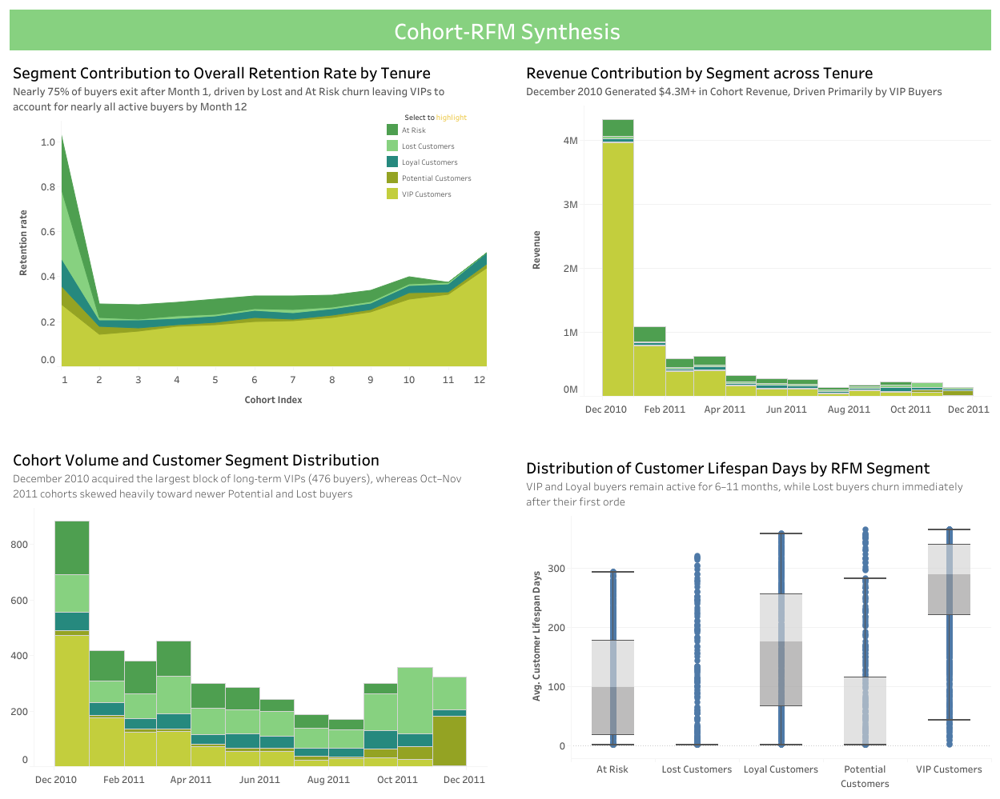

# Customer Retention & Lifecycle Value Analytics | Cohort & RFM Segmentation

**Project type:** Independent data analytics portfolio

**Reporting scope:** E-commerce transaction history (December 2010 – November 2011; 4,297 unique customers; \$8.36M total revenue)

**Business context:** Diagnosing post-purchase customer attrition, cohort retention trajectories, and revenue concentration across RFM behavioral segments

**Primary tools:** Microsoft SQL Server (T-SQL), Tableau Public, Microsoft Excel

[View the interactive Tableau Cohort | RFM Dashboard](https://public.tableau.com/views/Cohort-RFMcombineddashboard/cohort-RFM?:language=en-US&:sid=&:redirect=auth&:display_count=n&:origin=viz_share_link) | [Cohort Retention SQL Script](SQL_queries/cohort_retention.sql) | [RFM Segmentation SQL Script](SQL_queries/Customer_Segmentation.sql)

## Table of Contents

* [1. Project Overview](#1-project-overview)

* [2. Business Problem & Analytical Scope](#2-business-problem--analytical-scope)

* [3. Dataset Overview & Data Hygiene](#3-dataset-overview--data-hygiene)

* [4. Executive Summary](#4-executive-summary)

* [5. Exploratory Analysis: Iterative Hypothesis Loops](#5-exploratory-analysis-iterative-hypothesis-loops)

  * [5.1 Cohort Retention Trajectory (When Are Customers Leaving?)](#51-cohort-retention-trajectory-when-are-customers-leaving)

  * [5.2 RFM Value Segmentation (Who Sustains Revenue?)](#52-rfm-value-segmentation-who-sustains-revenue)

  * [5.3 Combined Cohort-RFM Diagnosis (The Month-1 Natural Filter)](#53-combined-cohort-rfm-diagnosis-the-month-1-natural-filter)

  * [5.4 Acquisition Quality by Cohort Month (Volume vs. Customer Quality)](#54-acquisition-quality-by-cohort-month-volume-vs-customer-quality)

* [6. Recommendations & Business Implications](#6-recommendations--business-implications)

* [7. Limitations & Further Investigation](#7-limitations--further-investigation)

* [8. Project Files & Deliverables](#8-project-files--deliverables)

## 1. Project Overview

Top-line transaction totals often mask high customer turnover after an initial purchase. This project investigates **when customers churn after their first order, how revenue is distributed across behavioral customer segments, and how customer quality varies across monthly acquisition cohorts** between December 2010 and November 2011.

By combining **time-based Cohort Retention analysis** with **RFM (Recency, Frequency, Monetary) quintile segmentation** in T-SQL and visualizing the combined lifecycle in Tableau, the analysis distinguishes one-time buyers from repeat high-value customers.

**Scope:** 12 monthly acquisition cohorts (`December 2010` through `November 2011`), excluding partial December 2011 records so incomplete month activity does not distort retention rates.

[Back to Table of Contents](#table-of-contents)

## 2. Business Problem & Analytical Scope

Across **4,297 unique customers** and **\$8.36 million in net revenue** (December 2010 – November 2011), aggregate revenue figures conceal steep early-stage customer attrition. While the **December 2010 cohort** demonstrated strong long-term durability—retaining **50.3%** of its initial 885 buyers by Month 12—subsequent 2011 cohorts experienced sharper post-purchase drop-offs, frequently falling below 30% retention within six months.

Rather than assuming all churn carries equal financial impact, this investigation uses transactional invoice records (`InvoiceNo`, `StockCode`, `Description`, `Quantity`, `InvoiceDate`, `UnitPrice`, `CustomerID`, `Country`) to answer four core diagnostic questions:

| Diagnostic Question | Key Metric in Dataset | Analytical Objective | 
| ----- | ----- | ----- | 
| **1. Churn Timing** | **\~75% drop-off after Cohort Index 1** | Identify the exact lifecycle month where customer attrition peaks and where retention stabilizes | 
| **2. Value Concentration** | **\$6.24M (VIPs)** vs. **\$340K (Lost)** | Quantify how total revenue and order frequency are distributed across RFM customer tiers | 
| **3. Revenue at Risk** | **\$1.14M across 883 At-Risk buyers** | Measure historical revenue tied to previously active buyers whose purchase recency has lapsed | 
| **4. Cohort Quality** | **885 buyers in Dec 2010** vs. **2011 cohorts** | Compare customer segment composition across acquisition months to evaluate volume vs. retention durability | 

**Scope Boundary:** Because the source dataset captures transactional line items without marketing channel attribution, acquisition spend, or customer survey responses, this analysis diagnoses **observed behavioral retention patterns and revenue concentration** rather than claiming to prove upstream marketing or operational root causes.

[Back to Table of Contents](#table-of-contents)

## 3. Dataset Overview & Data Hygiene

The SQL pipeline cleans the raw `Online_Retail` table and structures it into two analytical datasets for Tableau visualization:

| Table / Output | Grain | Data Cleaning & Engineering Rules | 
| ----- | ----- | ----- | 
| `Online_Retail_Main` | Invoice line-item level | Calculated `Revenue = Quantity * UnitPrice`; removed records with `CustomerID IS NULL`, cancellations/returns (`Quantity <= 0`), non-positive prices (`UnitPrice <= 0`), and duplicate invoice lines (`ROW_NUMBER() = 1`) | 
| `Cohort_Retention` | Customer × Transaction × Cohort Index | Assigned each buyer's first purchase month as `CohortDate` and computed `Cohort_Index` (`1` to `12`); excluded December 2011 (`NOT (YEAR(InvoiceDate) = 2011 AND MONTH(InvoiceDate) = 12)`) to avoid incomplete-month truncation | 
| `RFM_Segments_Final` | One row per unique `CustomerID` (**4,297 total customers**; **3,886 displayed in Index-1 cohort matrix**) | Calculated `Recency` (days from latest invoice date `2011-11-30`), `Frequency` (`COUNT(DISTINCT InvoiceNo)`), `Monetary` (`SUM(Revenue)`), `CustomerLifespanDays`, and quintile scores via `NTILE(5)` | 

**Tooling used:** Microsoft SQL Server (T-SQL window functions, `NTILE(5)`, `PIVOT` cohort tables, and `ROW_NUMBER()` deduplication), Tableau Public (interactive heatmaps, stacked area charts, box plots, and segment scorecards), and Microsoft Excel.

[Back to Table of Contents](#table-of-contents)

## 4. Executive Summary

Retention analysis reveals an immediate post-purchase drop-off: approximately **75% of newly acquired customers do not return after their first purchase month (`Cohort Index 1` to `Index 2`)**. While the **December 2010 cohort** generated **\$570,125 in Month 1** and retained **50% of its cohort by Month 12 (\$511,804)**, 8 of the 11 subsequent cohorts from January to October 2011 fell below **30% retention** after Month 6.

Combining RFM segmentation with cohort tenure explains why total revenue remained concentrated despite high headline attrition. **Lost Customers** represent the largest group in the cohort matrix (**1,340 customers**) but generate only **\$339,921** in revenue, averaging **1.1 orders**, **\$254 in spend**, and a **13.8-day lifespan**. In contrast, **VIP Customers (1,193 users)** generate **\$6,238,561**—roughly three-quarters of total revenue—averaging **9.7 orders**, **\$5,229 in spend**, **19 days recency**, and a **266.3-day lifespan**.

**Decision:** Prioritize CRM retention efforts within the **first 30 days after a buyer's initial purchase (`Index 1` to `Index 2`)**, protect the **1,193 VIP Customers** driving \$6.24M in revenue through tenure milestones, and deploy targeted win-back outreach to the **883 At-Risk buyers** representing \$1.14M in historical spend.

[Back to Table of Contents](#table-of-contents)

## 5. Exploratory Analysis: Iterative Hypothesis Loops

Each analytical stage tests a specific behavioral question and uses the resulting evidence to guide the next step of the investigation.

### 5.1 Cohort Retention Trajectory (When Are Customers Leaving?)

* **Initial Question:** Across monthly acquisition cohorts, at what exact point after first purchase does retention drop sharpest, and how do 2011 cohorts compare against December 2010?

* **SQL / Visual Evidence:** Cohort retention count matrices, retention percentage heatmaps (`Cohort_Index 1` through `12`), and cohort revenue tables track repeat purchasing across cohorts.

* **Key Findings:**

  * **The Month-1 Drop-Off:** Across 2011 cohorts, retention drops from **100% at Index 1** to between **15% and 24% at Index 2**, showing that roughly three-quarters of new buyers fail to make a second-month purchase.

  * **Post-Month-2 Stabilization:** After Index 2, retention rates stabilize within a **20% to 35% range** through Index 10 rather than continuing to collapse linearly.

  * **December 2010 vs. 2011 Cohorts:** The **December 2010 cohort** (885 customers) retained **37% at Index 2** and climbed back to **50% at Index 12**, sustaining **\$570,125 in Month 1** and **\$511,804 in Month 12**. Subsequent 2011 cohorts recorded smaller initial customer counts and lower retention rates (<30% beyond Month 6).

**Business Implication:**

Customer attrition is heavily concentrated in the immediate post-purchase window rather than spread evenly across the customer lifecycle. Focusing retention campaigns late in the tenure cycle (Months 6–12) misses the primary point of failure, because the majority of churn occurs before Month 2. Retention resources should therefore be concentrated on driving a second transaction within the first 30 days after initial purchase, while auditing product mix and order patterns from December 2010 to understand what supported its 50% Month-12 retention.

* **Next Question:** *Is this 75% Month-1 churn eroding the core revenue base, or are the customers leaving primarily low-value, one-time buyers?*

### 5.2 RFM Value Segmentation (Who Sustains Revenue?)

* **Hypothesis:** Total revenue and repeat order volume are concentrated among a smaller subset of high-frequency buyers, meaning raw headcount churn overstates financial loss.

* **SQL Method:** Ranked customers into quintiles (`NTILE(5)`) across `Recency`, `Frequency`, and `Monetary` value, grouping buyers into five behavioral segments: **VIP Customers**, **Loyal Customers**, **Potential Customers**, **At Risk**, and **Lost Customers**.

* **Key Findings:**

  * **VIP Revenue Concentration (`VIP Customers`):** Comprising **1,193 customers**, VIPs generate **\$6,238,561** in revenue (**\$5,229 average spend**), averaging **9.7 orders**, **19 days recency**, and a **266.3-day customer lifespan**.

  * **Low-Spend One-Time Churn (`Lost Customers`):** The largest group by customer count (**1,340 buyers**) contributes only **\$339,921** total (**\$254 average spend**), averaging **1.1 orders**, **157 days recency**, and a **13.8-day lifespan**.

  * **High-AOV Lapsed Buyers (`At Risk`):** Accounting for **883 customers** and **\$1,138,788 in revenue** (**\$1,290 average spend**), `At Risk` buyers have the highest average order value (**\$592.90**) and **2.8 average orders**, but have not purchased in **154 days**.

| Customer Segment | Customer Count | Total Revenue | Avg. Orders | Avg. Monetary | Avg. Order Value | Avg. Recency (Days) | Avg. Lifespan (Days) | 
| ----- | ----- | ----- | ----- | ----- | ----- | ----- | ----- | 
| **VIP Customers** | 1,193 | \$6,238,561 | 9.7 | \$5,229 | \$470.50 | 19 | 266.3 | 
| **At Risk** | 883 | \$1,138,788 | 2.8 | \$1,290 | \$592.90 | 154 | 104.8 | 
| **Loyal Customers** | 526 | \$476,621 | 3.0 | \$906 | \$348.80 | 28 | 169.7 | 
| **Potential Customers** | 355 | \$168,103 | 1.7 | \$474 | \$366.00 | 14 | 71.0 | 
| **Lost Customers** | 1,340 | \$339,921 | 1.1 | \$254 | \$234.60 | 157 | 13.8 | 

**Business Implication:**

Allocating uniform retention spend across all customer tiers ignores dramatic differences in unit economics. The business relies on **VIP and Loyal customers**—whose high order frequency (3.0 to 9.7 orders) and extended lifespans generate the vast majority of cash flow. Broad discounting aimed at **Lost Customers** (1.1 average orders, \$254 total spend) targets low-engagement buyers with minimal lifetime value, whereas targeted win-back campaigns for **At Risk** buyers (\$1,290 average spend, \$592.90 AOV) focus directly on recovering proven high-ticket accounts before they lapse permanently.

* **Next Question:** *When Cohort Index and RFM segments are combined, how do these five tiers behave across the 12-month retention curve?*

### 5.3 Combined Cohort-RFM Diagnosis (The Month-1 Natural Filter)

* **Hypothesis:** The steep 75% retention drop after `Index 1` is caused almost entirely by one-time `Lost Customers` exiting immediately, leaving a stable base of `VIP` and `Loyal` buyers.

* **Visual Evidence:** Combined stacked area retention charts, `Cohort Index × RFM Segment` count tables, and customer lifespan box plots validate segment persistence across cohort tenure.

* **Key Findings:**

  * **The Month-1 Filter Effect:** Between `Cohort Index 1` and `Index 2`, `Lost Customers` fall from **1,340 to 23** (an immediate 98.3% exit), and `At Risk` users drop from **883 to 200**. By contrast, `VIP Customers` retain **563 active buyers at Index 2** and remain above **500 active buyers** through `Index 10`.

  * **Lifespan Box-Plot Validation:** `CustomerLifespanDays` distributions confirm clear behavioral separation—`Lost Customers` cluster near zero tenure, whereas `VIP` and `Loyal` segments show elevated median lifespans and interquartile ranges spanning roughly **180 to 290+ days**.

**Business Implication:**

Integrating Cohort and RFM views clarifies that the 75% Month-1 churn rate functions as a **behavioral filter** separating one-time transactional shoppers from durable repeat buyers. Rather than treating Month-1 attrition as uniform customer loss, CRM strategy should split into two distinct workflows: **early conversion nudges** (Days 7–30) aimed at moving `Potential Customers` (1.7 orders, 14-day recency) into the `Loyal` tier before they become `Lost`, and **VIP retention reinforcement** (Indices 6–12) to safeguard the ~500 core power users who sustain long-term revenue.

* **Next Question:** *How does the mix of VIP, Loyal, and Lost buyers vary across different acquisition months?*

### 5.4 Acquisition Quality by Cohort Month (Volume vs. Customer Quality)

* **Hypothesis:** High-volume acquisition months bring in a large share of one-time `Lost Customers`, whereas smaller cohorts can deliver a higher proportion of repeat `VIP` and `Loyal` buyers.

* **Visual Evidence:** Stacked cohort volume and RFM segment distribution charts compare initial cohort size against resulting segment composition from December 2010 through November 2011.

* **Key Findings:**

  * **High Volume with Mixed Quality (`December 2010`):** December 2010 generated the largest cohort (885 customers) and a large absolute core of VIPs, but also included a substantial block of one-time `Lost Customers`.

  * **2011 Cohort Shifts:** Total monthly cohort volume declined from Q1 through Q3 2011 while the relative share of `Lost` and `At Risk` buyers increased, followed by a late-year rise in `Potential` and `Loyal` buyers in October and November 2011.

**Business Implication:**

Measuring acquisition success solely by first-month customer headcount obscures large variations in downstream customer quality. Peak-volume periods often bring in one-time shoppers who churn within two weeks, inflating top-line acquisition counts while depressing blended retention rates. Evaluating monthly cohorts by their **share of VIP and Loyal buyers** rather than raw initial headcount provides a cleaner benchmark for assessing customer quality across seasons.

[Back to Table of Contents](#table-of-contents)

## 6. Recommendations & Business Implications

The combined Cohort and RFM findings prioritize **first-30-day repeat purchase activation, VIP milestone retention, and targeted win-back outreach for high-AOV At-Risk accounts**.

| Priority | Observed Pattern in Data | Recommended Action | Expected Business Outcome | Success Metrics | 
| ----- | ----- | ----- | ----- | ----- | 
| **Critical** | \~75% of buyers drop off after `Cohort Index 1`, with 1,340 users classified as `Lost` after 1.1 orders. | Implement a **7-, 14-, and 30-day post-first-purchase follow-up sequence** focused on driving a second order among new and `Potential` buyers. | Improve `Index 1` to `Index 2` retention and convert one-time shoppers into repeat buyers. | Index-1 to Index-2 retention rate, second-order conversion rate, 30-day repeat revenue. | 
| **High** | `VIP Customers` (1,193 users) generate **\$6.24M** across 9.7 average orders and a 266.3-day lifespan. | Introduce **milestone loyalty recognition at `Index 6` and `Index 12`** (early access, tiered perks, priority service) to protect core VIPs. | Preserve the primary revenue base and extend VIP purchase lifespans. | VIP retention at Index 6/12, VIP order frequency, total VIP revenue share. | 
| **High** | `At Risk` buyers (883 users) represent **\$1.14M** in historical spend (\$592.90 AOV) with 154 days average recency. | Launch targeted **win-back offers** for `At Risk` accounts whose historical lifespan exceeds the segment median (>20 days). | Recover high-AOV lapsed buyers without discounting low-LTV `Lost` accounts. | At-Risk reactivation rate, incremental win-back revenue, average order value. | 
| **Medium** | 1,340 buyers are tagged `Lost` immediately after Index 1; cohort quality varies significantly by acquisition month. | Test extending the new-buyer recency window (e.g., **60 days vs. 30 days**) before suppressing outreach, and benchmark cohorts by VIP share. | Reduce premature suppression of slower-cycle buyers and align acquisition goals with cohort quality. | 60-day reactivation rate, cohort VIP/Loyal share %, Index-3 retention rate. | 

### Implementation Priorities

**1. Immediate Priority — First-30-Day Second-Order Activation**

Concentrate onboarding outreach between `Cohort Index 1` and `Index 2`, where 75% of cohort attrition occurs.

**2. Secondary Priority — VIP Protection & High-AOV Win-Backs**

Protect the 1,193 `VIP Customers` generating \$6.24M in revenue while targeting high-AOV `At Risk` accounts (\$1.14M revenue pool) for selective reactivation.

**3. Strategic Priority — Quality-Weighted Cohort Benchmarking**

Evaluate monthly acquisition cohorts using **Index-3 retention and VIP/Loyal share** alongside raw initial customer count.

[Back to Table of Contents](#table-of-contents)

## 7. Limitations & Further Investigation

To ensure disciplined interpretation of these results, four dataset limitations must be noted:

1. **Right-Censoring of Late-2011 Cohorts:** Cohorts acquired in October and November 2011 have only 1 to 2 observable months prior to the dataset cutoff (`2011-11-30`), meaning their long-term retention and VIP conversion cannot yet be fully observed.

2. **No Marketing Attribution or Cost Data:** The `Online_Retail` dataset contains transactional invoice fields (`InvoiceNo`, `StockCode`, `Quantity`, `UnitPrice`, `InvoiceDate`, `CustomerID`, `Country`) but lacks acquisition channel tags, ad spend, and product COGS—preventing direct CAC or net-margin LTV calculations.

3. **Mixed B2B Wholesale and B2C Retail Orders:** High average order values in the `At Risk` (\$592.90) and `VIP` (\$470.50) segments suggest the presence of bulk wholesale buyers alongside individual retail consumers, which can influence order frequency and recency distributions.

4. **Relative Quintile Scoring (`NTILE(5)`):** Because `NTILE(5)` partitions customers into equal 20% buckets relative to this specific dataset, fixed business-rule thresholds (exact day cutoffs and spend tiers) should be validated before deploying automated CRM triggers.

### Areas for Further Investigation

| Investigation Area | Additional Data Required | Analytical Objective | 
| ----- | ----- | ----- | 
| First-Purchase Product Affinity | Product category mappings and initial basket SKU analysis (`FirstProduct` query) | Identify which entry SKUs correlate with higher Month-2 repeat orders vs. immediate churn. | 
| Wholesale vs. Retail Segmentation | Customer account type flags or order-quantity distribution clustering | Separate B2B bulk buyers from B2C retail shoppers to tailor distinct retention cadences. | 
| Margin-Adjusted Retention ROI | Product-level cost of goods sold (COGS) and discount/return deductions | Ensure VIP rewards and At-Risk win-back offers protect net contribution margin. | 

[Back to Table of Contents](#table-of-contents)

## 8. Project Files & Deliverables

| Deliverable | Description | 
| ----- | ----- | 
| [Interactive Tableau Dashboard](https://public.tableau.com/views/Cohort-RFMcombineddashboard/cohort-RFM?:language=en-US&:sid=&:redirect=auth&:display_count=n&:origin=viz_share_link) | Three-dashboard interactive workbook covering Cohort Retention Overview, RFM Segmentation Overview, and Combined Cohort-RFM Insights | 
| [Cohort Retention SQL Script](SQL_queries/cohort_retention.sql) | T-SQL data cleaning, `ROW_NUMBER()` deduplication, cohort index construction, `PIVOT` retention tables, CLV, and churn queries | 
| [RFM Segmentation SQL Script](SQL_queries/Customer_Segmentation.sql) | T-SQL `NTILE(5)` quintile scoring, segment classification, `@AtRiskRevenue` calculation, and ML feature export | 
| [Cohort Retention Overview Chart](images/Cohort_retention_overview.jpg) | Monthly cohort retention counts, retention rate heatmap, and cohort revenue matrix | 
| [RFM Segmentation Chart](images/RFM_Segmentation.png) | Segment distribution, revenue contribution, recency-vs-monetary scatter plot, and lifespan metrics | 
| [Combined Cohort-RFM Chart](images/cohort_RFM.png) | Segment contribution area chart, index-by-segment matrix, and customer lifespan box plots | 

[Back to Table of Contents](#table-of-contents)
